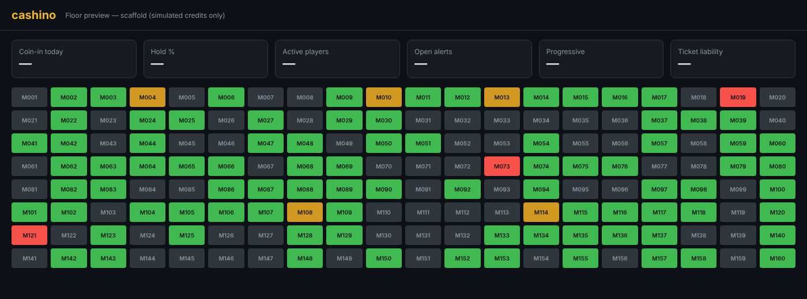

# cashino

A portfolio-grade **Casino Management System (CMS) simulator** that mirrors how real slot-floor systems are structured.

> **Simulation only.** Fake credits, no real money, no real player data. `cashino` is an original product; it implements an
> original, SAS-*inspired* event model and is not affiliated with or a copy of any vendor's system or protocol spec.

_Status: work in progress — the full backend, simulator, and dashboard are being built on this branch. This screenshot is a
preview of the floor layout and will be replaced with a capture of the running dashboard._

## Planned components

- **Go backend** — machine interface (TCP + WebSocket), event ingestion with de-dup and gap detection, append-only
  PostgreSQL event log, slot accounting, player tracking, TITO, bonusing rule engine, progressives, alerts, audit + RBAC,
  reporting (CSV/PDF).
- **Cabinet simulator** — up to 500 seeded virtual machines, replay mode, Unity adapter.
- **React + TypeScript dashboard** — live floor (tiles + Three.js 3D view), KPIs, player lookup, audit log viewer.
- **Docker Compose** — one command to run everything.
